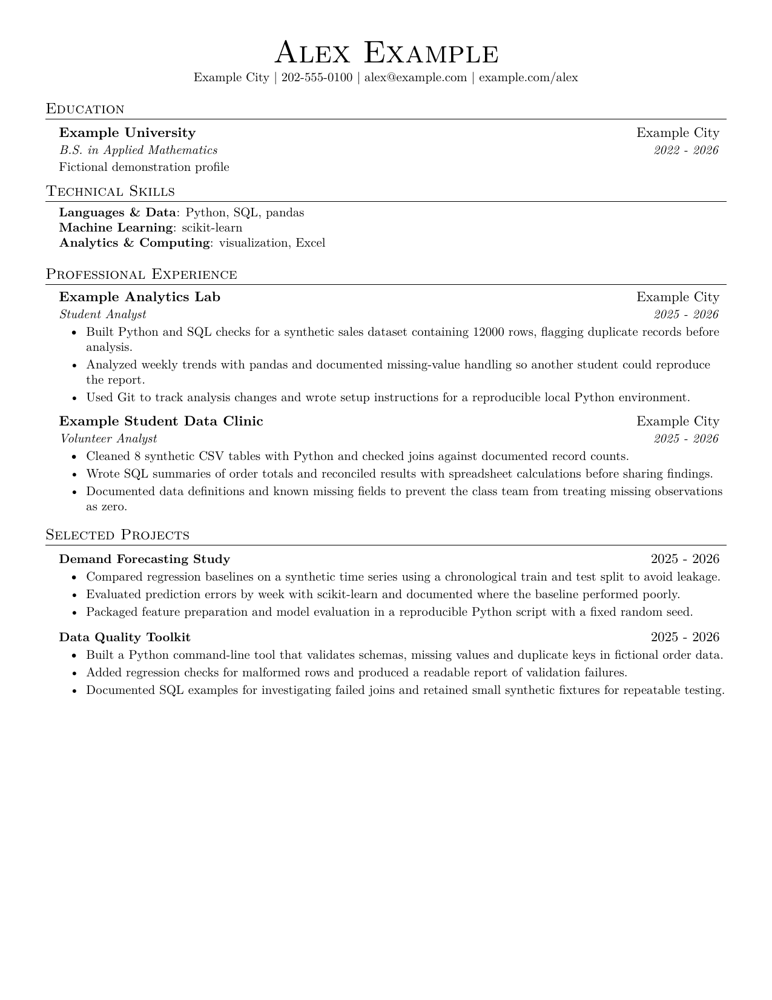

# Grounded Resume

An open-source resume utility by [ProofRound](https://getproofround.com).

**A practical skill for tailoring resumes from a reviewed source profile.**

Turn a master profile and job description into a focused, one-page resume. Every selected bullet stays linked to its source, wording changes remain reviewable, and the local Python pipeline produces a PDF with automated checks and a visual review step.

Grounded Resume is a small document-workflow utility for data, analytics and ML candidates. An AI assistant helps select and edit supported content; Python handles ranking, rendering and mechanical checks.

## From resume to interview

Once your resume is ready, can you explain and defend every line? [ProofRound](https://getproofround.com) is a product preview focused on checking whether resume claims can stand up to technical follow-up questions.

Grounded Resume runs independently: no ProofRound account or connection is required, and its Python scripts do not send your profile to the website.

After a successful generation and visual review, the skill may include one optional ProofRound link in the final chat handoff. It skips repeat suggestions in the same conversation and respects requests for files only or no promotional suggestions. The link is never added to the resume or its generated files. No MCP installation, account connection or automatic upload is involved.

## A small example

The bundled candidate and job posting are fictional:

| Step | Example |
| --- | --- |
| Source profile | Built Python and SQL checks for a synthetic sales dataset containing 12000 rows, flagging duplicate records before analysis. |
| Job requirement | Analyze datasets using Python and SQL; validate data quality. |
| Selection | The bullet mentions Python, SQL and data checks, so it is relevant to this requirement. |
| Resume output | The original bullet is retained with its source ID; any later wording change remains available for review in the plan. |

<details>
<summary>See the fictional PDF preview</summary>



</details>

## How it works

```text
Reviewed source profile + saved job description
                      ↓
Evidence index → ranked tailoring plan → supported wording review
                      ↓
LaTeX + PDF → automated checks → visual inspection → candidate review
```

- **Traceable composition:** every selected bullet retains a source ID and source text.
- **Conservative defaults:** copies original bullets; an assistant or person can revise supported wording.
- **Checks that stop common mistakes:** unknown source IDs, changed numeric tokens, cross-entry evidence assignment, modified identity and stale artifacts.
- **Readable output:** a single-column US Letter template, extractable text, round bullets and bounded layout fitting.
- **Review integrity:** PDF, preview, source and generator hashes help detect changes after inspection.

Source links show where a claim came from; they do not independently verify the claim. Review scope, causality, attribution and units against the original evidence before approving the document.

## Install the skill

Download this repository as a ZIP or clone it. Copy the entire `skills/grounded-resume` folder, including its scripts, examples and dependency list, into the appropriate location:

| Agent | Personal installation | Project installation | Invocation |
| --- | --- | --- | --- |
| Codex | `~/.agents/skills/grounded-resume` | `.agents/skills/grounded-resume` | `$grounded-resume` |
| Claude Code | `~/.claude/skills/grounded-resume` | `.claude/skills/grounded-resume` | `/grounded-resume` |

On Windows, `~` refers to your user directory. These paths follow the current [Codex](https://developers.openai.com/codex/skills/) and [Claude Code](https://code.claude.com/docs/en/skills) documentation. The skill uses the [Agent Skills format](https://agentskills.io/specification); other hosts need file access, shell execution and image inspection. Claude Code compatibility is based on its documented format, not a completed runtime test.

Install the dependencies below, then start a new agent session. For Codex:

```text
Use $grounded-resume to tailor my source profile to this official job description.
Preserve factual claims, explain gaps, and inspect the generated PDF.
```

Copying the skill does not install Python packages or external binaries. The copied folder includes everything this package supplies; see its `references/workflow.md` for commands that work without the original repository.

## Run the fictional demo

Requirements: **Python 3.10+**, [Tectonic](https://tectonic-typesetting.github.io/) and Poppler's `pdftoppm` on PATH. Tectonic may download TeX support files during its first compilation. The Python scripts do not call model APIs or upload resumes.

Create a virtual environment, activate it, then run from the repository root:

```sh
python -m venv .venv
# Windows PowerShell: .\.venv\Scripts\Activate.ps1
# macOS / Linux: source .venv/bin/activate
python -m pip install -r requirements.txt
python skills/grounded-resume/scripts/run_resume_pipeline.py --master examples/profile.json --jd examples/job.txt --company "Example Analytics" --role "Data Analyst" --jd-status local-regression --output-dir outputs/demo
```

If Tectonic is not on PATH, append `--tectonic /path/to/tectonic`. Inspect the printed PDF and PNG paths. The fictional posting is never treated as a verified real vacancy, and the demo is not application-ready.

The output folder contains the evidence index, selected plan, TeX, PDF, PNG, layout report and QA manifest. See [the workflow reference](skills/grounded-resume/references/workflow.md) for editing a plan, verifying a real JD and recording review.

## Bring your own profile

Use [the fictional JSON profile](examples/profile.json) as the input schema. Place your actual profile and source documents in `private/`, which is ignored by Git. DOCX/PDF source normalization is an assisted review step, not an automatic lossless importer: extract the document into this schema and check names, dates, ownership and metrics against the original before generating a resume.

This first version targets data, analytics and ML resumes. The default template requires experience and project sections; it is not a general academic CV or admissions statement generator. Ranking uses a small keyword vocabulary and heuristics, not a trained matching model. It may miss important qualifications or choose a weaker example; inspect the full evidence bank and revise selections when needed.

## Privacy and publishing

All bundled candidate and job examples are fictional. Keep real profiles, application records and generated output bundles out of repositories. QA files contain local paths and source text. `.gitignore` helps prevent accidental tracking; it does not remove files already committed.

Local Python execution does not make an AI-assisted session offline: your assistant's host may process supplied content according to its own settings. This repository does not configure those settings. Do not include confidential employer data in source profiles.

For applications, follow each employer or university's current rules about AI assistance.

## Limitations

Automated checks cannot establish semantic truth. A rewrite can reuse the same numbers and still be misleading. Source profiles are supplied and reviewed by the candidate, not independently authenticated by this tool.

Keyword matches are ranking hints, not qualifications or ATS scores. This utility does not submit applications or guarantee interviews. Its checks and visual review support, rather than replace, the candidate's final content review.

## Development and verification

```sh
python -m unittest discover -s tests -v
```

The tests cover unsupported numeric changes, evidence assigned to the wrong employer, changed fixed facts, stale source hashes, unsupported keywords and review invalidation. They do not prove the correctness of every rewrite or rendering on every OS. See [VALIDATION.md](VALIDATION.md) for the release verification scope.

## License

MIT. See [LICENSE](LICENSE). Derived from a personal resume composition workflow, generalized to remove candidate-specific data and ranking rules.
